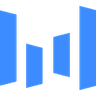
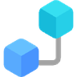

# IconSet
# IconSet

A personal icon collection designed to enhance the visual appearance of proxy configurations and policy groups. It provides reusable icons for online services, platforms, and custom rules, primarily for use with Stash and other compatible proxy tools.

个人整理与维护的图标资源集合，图标均收集自互联网，个人配置提供统一的图标资源。本项目仅供个人学习、整理及非商业用途使用。

## 📦 项目内容

- **`chungccicon.json`**：图标集索引文件，定义图标名称及对应的图片地址。
- **图片资源**：存放各类服务、平台及自定义用途的图标。
- **`icon/`**：其他图标资源目录。

## 🖼️ 图标分类

本项目收录的图标包括但不限于：

- **社交媒体**：Instagram、Telegram、TikTok、WhatsApp、iMessage
- **流媒体与娱乐**：Netflix、YouTube、Spotify、IMDb
- **开发与 AI**：GitHub、ChatGPT
- **互联网服务**：Google、Microsoft、Steam
- **网络与自定义标识**：Home、Smart、Oversea 等

## 📁 项目地址

- GitHub 仓库：[chungccc/IconSet](https://github.com/chungccc/IconSet)
- 图标集索引：[chungccicon.json](https://github.com/chungccc/IconSet/blob/main/chungccicon.json)
- Raw JSON：[chungccicon.json（Raw）](https://raw.githubusercontent.com/chungccc/IconSet/main/chungccicon.json)

## 版权声明

- 本项目所收录的图标均来源于互联网公开资源，版权及相关知识产权归原作者或原版权持有人所有。
- 本项目仅对收集的图标进行整理、分类与索引，不主张拥有相关图标的版权。
- 所有图标仅供个人学习、研究及非商业用途使用。
- 如相关图标涉及版权或其他合法权益，请联系项目维护者，核实后将及时处理或删除。
- 未经原版权持有人授权，请勿将相关图标用于商业用途或声称拥有其版权。

## 🖼️ 图标预览

以下图标根据 `chungccicon.json` 自动生成。

<!-- ICON-GALLERY:START -->

<table align="center">
  <tbody>
    <tr>
      <td align="center" valign="middle"> 18</td>
      <td align="center" valign="middle"> 18b</td>
      <td align="center" valign="middle"> HKTLOGO</td>
      <td align="center" valign="middle"> ash</td>
      <td align="center" valign="middle"> aws</td>
      <td align="center" valign="middle"> bytedance</td>
    </tr>
    <tr>
      <td align="center" valign="middle"> ct</td>
      <td align="center" valign="middle"> download</td>
      <td align="center" valign="middle"> exitrun</td>
      <td align="center" valign="middle"> github-badge-256px</td>
      <td align="center" valign="middle"> github-light-256px</td>
      <td align="center" valign="middle"> google-256px</td>
    </tr>
    <tr>
      <td align="center" valign="middle"> heart</td>
      <td align="center" valign="middle"> home1</td>
      <td align="center" valign="middle"> homeadvisor</td>
      <td align="center" valign="middle"> imdb</td>
      <td align="center" valign="middle"> imessage</td>
      <td align="center" valign="middle"> in</td>
    </tr>
    <tr>
      <td align="center" valign="middle"> instagram-256px</td>
      <td align="center" valign="middle"> instagram</td>
      <td align="center" valign="middle"> lcb</td>
      <td align="center" valign="middle"> microsoft-256px</td>
      <td align="center" valign="middle"> netflix-256px</td>
      <td align="center" valign="middle"> openai-chatgpt-256px</td>
    </tr>
    <tr>
      <td align="center" valign="middle"> out</td>
      <td align="center" valign="middle"> oversea</td>
      <td align="center" valign="middle"> relay</td>
      <td align="center" valign="middle"> relay2</td>
      <td align="center" valign="middle"> router</td>
      <td align="center" valign="middle"> smart</td>
    </tr>
    <tr>
      <td align="center" valign="middle"> smart2</td>
      <td align="center" valign="middle"> spotify-256px</td>
      <td align="center" valign="middle"> steam-256px</td>
      <td align="center" valign="middle"> telegram-256px</td>
      <td align="center" valign="middle"> tiktok-light-256px</td>
      <td align="center" valign="middle"> time</td>
    </tr>
    <tr>
      <td align="center" valign="middle"> time2</td>
      <td align="center" valign="middle"> whatsapp-256px</td>
      <td align="center" valign="middle"> window2</td>
      <td align="center" valign="middle"> x</td>
      <td align="center" valign="middle"> youtube-256px</td>
      <td></td>
    </tr>
  </tbody>
</table>

<!-- ICON-GALLERY:END -->
